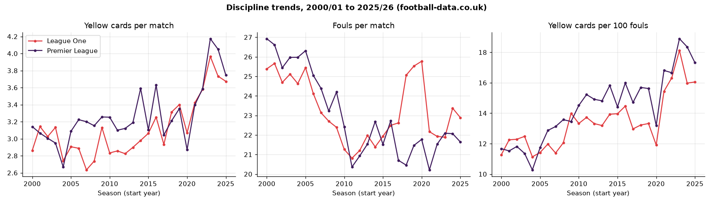
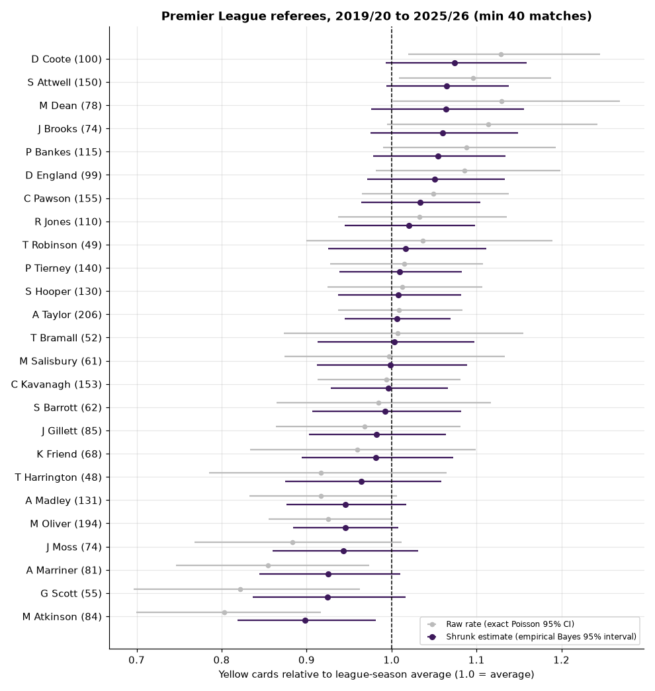
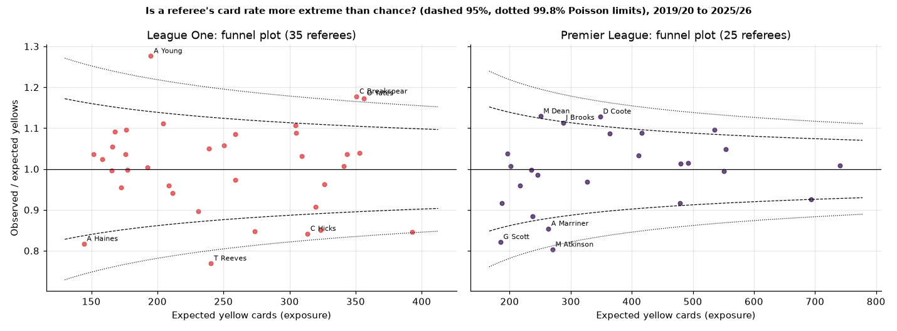
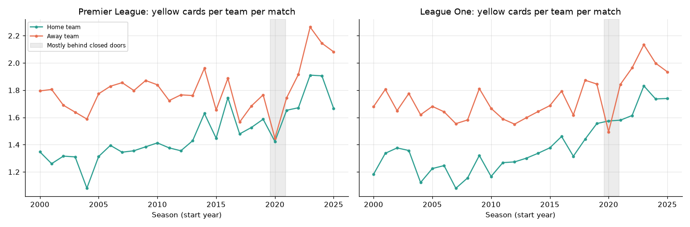
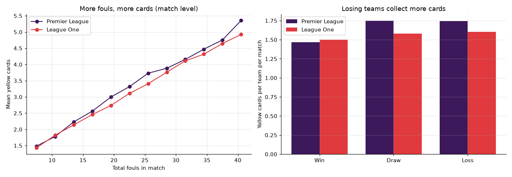
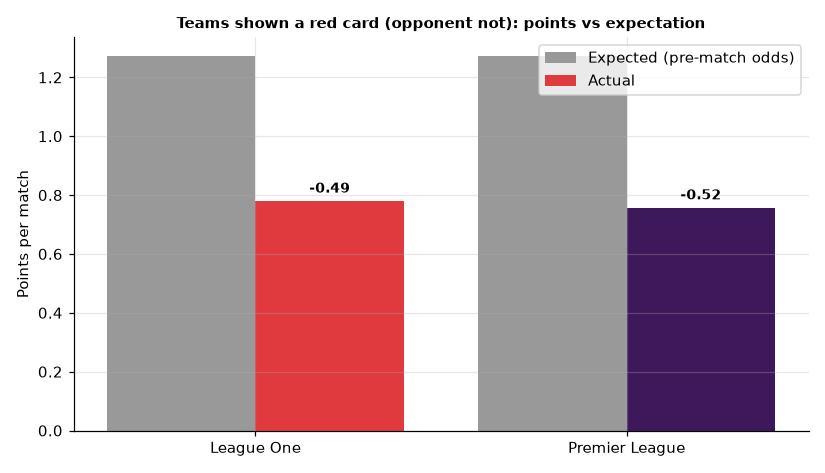
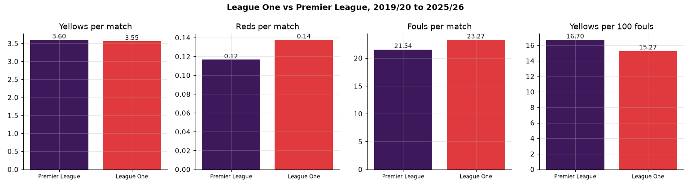
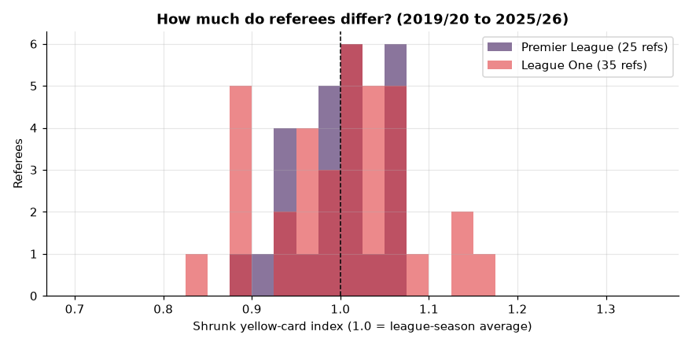

# Referee discipline in English football: Premier League vs League One, 2000/01 to 2025/26

Who are the strictest referees once you allow for luck? Do away teams really get booked more? Has football become
more card-happy? And is League One any rougher than the Premier League? This project answers these questions with
**23,565 matches** (9,790 Premier League, 13,775 League One) over 26 seasons, using a DuckDB SQL layer,
empirical Bayes shrinkage, Poisson models and an interactive Streamlit dashboard.

Author: Anthony Adusei-Poku ([@anthony07-max](https://github.com/anthony07-max))



## Key findings

| 2019/20 to 2025/26 | Premier League | League One |
|---|---|---|
| Yellow cards per match | 3.60 | 3.56 |
| Red cards per match | 0.117 | 0.138 |
| Matches with at least one red | 10.8% | 12.7% |
| Fouls per match | 21.5 | 23.3 |
| Yellow cards per 100 fouls | 16.7 | 15.3 |
| Away teams' extra yellows vs home teams (all seasons) | +22.2% | +25.1% |

1. **Referees are booking more for less.** Premier League fouls fell from 26.9 to 21.6 per match between 2000/01 and
   2025/26, but yellow cards rose from 3.14 to 3.75. That is 17.3 yellows per 100 fouls, up from 11.7. League One shows
   the same pattern (11.3 to 16.1 per 100 fouls). Both leagues peaked in **2023/24** (4.17 yellows per match in the
   Premier League and 3.97 in League One), the season the IFAB/PGMOL crackdown on dissent and time-wasting started.
   Red cards went the other way: 0.166 to 0.103 per match in the Premier League.
2. **Referee differences are real, but smaller than raw tables suggest.** Among 25 Premier League referees with 40+
   matches since 2019/20, card rates vary more than chance allows (chi-square 61.1 on 24 df, p < 0.001). After shrinkage,
   the spread between referees is about **6% (SD)** in the Premier League and **9%** in League One. Raw rates overstate it:
   for example, M Atkinson's raw index of 0.80 shrinks to **0.90 (95% interval 0.82 to 0.98)**.
   - Premier League, highest shrunk index: D Coote 1.07, S Attwell 1.07, M Dean 1.06. Lowest: M Atkinson 0.90, G Scott 0.93, A Marriner 0.93.
   - League One, highest: A Young 1.17 (1.06 to 1.30), C Breakspear 1.13, O Yates 1.13. Lowest: T Reeves 0.85 (0.75 to 0.94), S Oldham 0.88, C Hicks 0.89.
   - For **red cards**, the Premier League shows no referee variation beyond chance (estimated between-referee SD about 0).
     In League One it is around 14%.
3. **Away teams get booked more, even when they commit the same fouls.** Premier League away sides average 1.80 yellows
   against 1.48 for home sides. A Poisson model that controls for each team's fouls and the season still gives away teams
   **1.18 times the card rate (95% CI 1.15 to 1.21)**. The League One figure is 1.19 (1.17 to 1.22).
4. **The away-card gap disappeared without crowds.** In the 2020/21 behind-closed-doors season, the Premier League
   away-minus-home gap fell to **0.02 yellows per team** (compared with an average of 0.22 in 2015/16 to 2025/26, excluding the Covid seasons).
   In League One the gap reversed to -0.08 (normally +0.31). This suggests crowd pressure, not just away teams'
   playing style, drives much of the bias.
5. **Cards follow fouls and frustration.** At match level, fouls and yellows correlate at r = 0.34 in both leagues.
   Referees whose matches have more fouls also show more cards (r = 0.59 across Premier League referees, 0.35 in League One).
   Losing teams receive more yellows than winning teams (1.74 vs 1.47 per match in the Premier League) and **three
   times the reds** (0.110 vs 0.037).
6. **A red card costs about half a point.** Teams shown a red card (with no red for the opponent) took 0.76 points per match
   in the Premier League, against 1.27 expected from pre-match betting odds (**-0.52**, n = 1,109). In League One it was 0.78
   against 1.27 (-0.49, n = 1,720). This is not purely causal, because teams that are already losing pick up more reds.
7. **League One is not more card-heavy, just more foul-heavy.** Since 2019/20, yellows per match are almost identical
   (3.56 vs 3.60, Mann-Whitney p = 0.51). League One has 1.7 more fouls per match, so each foul is *less* likely to be
   punished. Holding fouls and season constant, the Premier League shows 7.4% more yellows than League One.

| | |
|---|---|
|  |  |
|  |  |
|  |  |



## Methods
- **Season-adjusted expectation.** Each match contributes its league-season average number of cards to a referee's
  *expected* total. The card index is observed divided by expected, so referees from high-card eras are not penalised for the era.
- **Uncertainty.** Raw indices use exact Poisson 95% intervals. Shrunk indices use a Gamma-Poisson empirical Bayes model:
  the between-referee variance is estimated by method of moments, and each referee is pulled towards 1.0 in proportion
  to how little data they have. Funnel plots show 95% and 99.8% control limits.
- **Home/away bias.** A Poisson GLM is fitted on team-match rows: `yellows ~ away + log(1 + fouls) + season`.
- **Match model.** `yellows ~ log(1 + fouls) + league + season + |goal difference|` (Poisson GLM).
- **Red card impact.** Expected points come from the market-average 1X2 odds (Bet365 when no average is available),
  normalised to remove the bookmaker margin.
- **SQL layer.** The summaries in [`sql/`](sql) run in DuckDB against the cleaned match table. They cover season trends,
  referee totals with expected cards, home/away and cards by result.

## Data source and licence
- [Football-Data.co.uk, England football results](https://www.football-data.co.uk/englandm.php): Premier League (`E0`)
  and League One (`E2`) season files, 2000/01 to 2025/26 ([column notes](https://www.football-data.co.uk/notes.txt)).
  Football-Data.co.uk provides the data free of charge. All credit for collecting it goes to Football-Data.co.uk and the
  sources it acknowledges (match statistics from BBC, ESPN and others; 2000/01 to 2001/02 statistics from Sports.com).
  This repository does **not** redistribute the raw files. `src/download.py` fetches them directly (with a polite
  delay), and only a small derived match table is committed. Football-Data.co.uk does not guarantee the accuracy of
  its data ([disclaimer](https://www.football-data.co.uk/disclaimer.php)). This is a non-commercial analysis project
  with no betting purpose. Betting odds are used only as a neutral measure of team strength before each match.

## Project structure
```
src/download.py        # fetches 52 season CSVs into data/raw/ (not committed)
src/clean.py           # normalises referee names, builds data/processed/matches.csv
src/analysis.py        # DuckDB SQL, shrinkage, GLMs, charts, key_findings.json
sql/*.sql              # SQL summaries run by analysis.py
app/streamlit_app.py   # interactive dashboard (trends, referee rankings, referee lookup)
charts/                # PNG outputs
data/processed/        # tidy CSVs + key_findings.json used by the dashboard
```

## How to run
```bash
python -m venv .venv && source .venv/bin/activate
pip install -r requirements.txt
./run_pipeline.sh                      # download, clean, analyse (about 1 minute)
streamlit run app/streamlit_app.py     # dashboard at http://localhost:8501
```

## Limitations
- English yellow-card counts on Football-Data.co.uk **exclude the first yellow** when a second yellow turns into a red.
  Those dismissals are counted as reds only.
- Some source season files are incomplete. Premier League 2003/04 and 2004/05 have 335 of 380 matches. League One
  2002/03 (351), 2004/05 (376) and the curtailed 2019/20 season (400) are also partial. League One 2012/13 has no
  referee column, so it is used for trends but not referee rankings.
- Referee names are normalised to "initial + surname". Two different officials with the same initial and surname would merge.
- Referee appointments are not random: senior referees get bigger and more heated matches. The index adjusts for
  league and season, but not for the fixture. This means it describes a referee's record more than it measures their strictness.
- Fouls are as recorded by the data providers, and recording practices may change over time.
